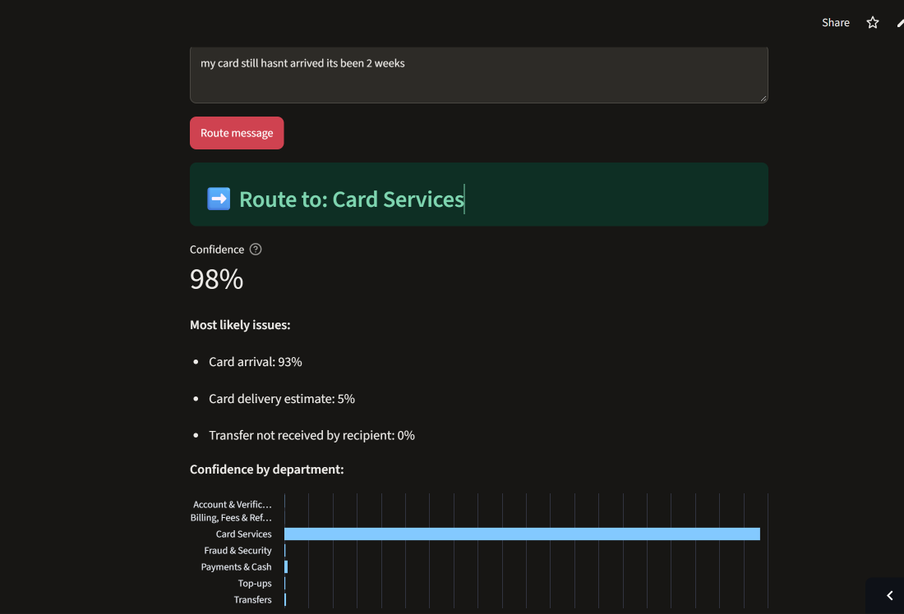

# 📨 Support Ticket Router

Reads a customer support message and routes it to the right department automatically. If the model isn't confident enough, it sends the message to a **human agent** instead of guessing.

**🔗 Live demo:** [support-ticket-routerr.streamlit.app](https://support-ticket-routerr.streamlit.app/)



---

## The problem

Support teams receive thousands of messages a day ("my card hasn't arrived", "I was charged twice", "someone used my card"). Someone has to read each message and forward it to the right team, which is slow and inconsistent. This project automates that first step:

1. **Understand** what the customer wants (77 specific issues).
2. **Route** the message to one of 7 departments.
3. **Hand off** to a human when the model is unsure.

---

## Results

The models were evaluated on 3,080 test messages they never saw during training.

| Model | Intent accuracy | Macro-F1 | Department accuracy |
|---|---|---|---|
| TF-IDF + Logistic Regression | 89.1% | 89.1% | 95.9% |
| **MiniLM embeddings + Logistic Regression** (used in app) | **93.0%** | **93.0%** | **97.7%** |
| MPNet embeddings + Logistic Regression | 93.7% | 93.7% | 98.1% |

### With the "send to human if unsure" rule (cut-off 0.6)

| | |
|---|---|
| Messages routed automatically | **96.0%** |
| Accuracy on those messages | **99.1%** |
| Messages sent to a human agent | 4.0% |

The model judges its own certainty well. It averages **88% confidence when it's right** and **53% when it's wrong**, so low confidence is a reliable warning sign.

| Cut-off | Auto-routed | Accuracy when auto-routed | Sent to human |
|---|---|---|---|
| None | 100% | 97.7% | 0% |
| **0.6 (chosen)** | **96.0%** | **99.1%** | **4.0%** |
| 0.8 | 89.9% | 99.7% | 10.1% |
| 0.9 | 82.6% | 99.9% | 17.4% |

0.6 was chosen as the best balance. Higher cut-offs gain very little accuracy but greatly increase the human workload.

---

## Key findings

- **Understanding meaning beats word-matching.** Pretrained sentence embeddings (transfer learning) improved intent accuracy by about 4 points over TF-IDF. They recognise that "my card hasn't come yet" and "where is my card?" mean the same thing, even though they share almost no words.
- **Routing by department removes most mistakes.** Most errors happen between near-identical intents (e.g. `verify_my_identity` vs `why_verify_identity`) that belong to the same team. Intent accuracy is 93%, but department accuracy is about 98%.
- **Model choice is a trade-off.** MPNet was 0.7 points more accurate than MiniLM, but it's 5× larger and slower. MiniLM was chosen for the live app because it runs well on a free server with almost no loss in accuracy.

### Example routing

| Customer message | Routed to | Confidence |
|---|---|---|
| my card still hasnt arrived its been 2 weeks | Card Services | 98% |
| someone used my card in another country, i didnt do that | Fraud & Security | 76% |
| why was I charged a fee when I took cash out? | Billing, Fees & Refunds | 100% |
| how do I send money to my brother's account? | Transfers | 87% |
| hello | **Human agent** | 38% |

---

## How it works

```
Customer message
      │
      ▼
MiniLM sentence encoder  ──►  384 numbers describing the message's meaning
      │
      ▼
Logistic regression      ──►  probability for each of 77 intents
      │
      ▼
Sum probabilities per department  ──►  7 department scores
      │
      ▼
Highest score ≥ 0.6 ?  ── yes ──►  Route to that department
      │
      no
      ▼
Route to human agent
```

1. **Data:** [BANKING77](https://huggingface.co/datasets/PolyAI/banking77) by PolyAI. It has 13,083 online-banking support messages labelled with 77 intents. I used the dataset's official train/test split (10,003 / 3,080).
2. **Department mapping:** I grouped the 77 intents into 7 departments (Card Services, Fraud & Security, Payments & Cash, Transfers, Top-ups, Billing, Fees & Refunds, Account & Verification). This grouping is a business design decision, stored in `models/config.json`.
3. **Models:**
   - **Baseline:** TF-IDF (words and word pairs) + logistic regression.
   - **Final:** the pretrained `all-MiniLM-L6-v2` sentence encoder turns each message into a meaning vector, and logistic regression classifies it.
4. **Department confidence:** the probabilities of all intents in a department are added up. If the model is split between two similar card intents, it's still confident about *Card Services*.
5. **Evaluation:** accuracy, macro-F1 (so small intents count as much as large ones) and department accuracy.
6. **Final model:** retrained on all 13,083 messages after evaluation.

---

## Project structure

```
support-ticket-router/
├── app/
│   └── app.py                     # Streamlit web app
├── images/                        # Screenshots for this README
├── models/
│   ├── intent_classifier.joblib   # Trained classifier
│   ├── config.json                # Encoder name, cut-off, department mapping
│   └── departments.json           # Intent → department lookup
├── notebooks/
│   ├── 01_exploration.ipynb       # Data exploration
│   └── 02_modeling.ipynb          # Models, evaluation, confidence routing
├── requirements.txt
└── README.md
```

---

## Run locally

```bash
git clone https://github.com/ahmedgill2005/support-ticket-router.git
cd support-ticket-router
python -m venv .venv
.venv\Scripts\activate          # Windows  (macOS/Linux: source .venv/bin/activate)
pip install -r requirements.txt
streamlit run app/app.py
```

To re-run the notebooks, also install Jupyter (`pip install jupyter matplotlib`). The first notebook downloads the dataset automatically.

---

## Limitations

- **Banking only:** the model was trained on banking messages, so a message about a different industry will usually go to a human (which is the safe outcome).
- **English only:** it doesn't handle Urdu or Roman Urdu.
- **One issue per message:** a message with two problems ("my card is blocked and I was charged twice") gets one department.
- **Test-set cut-off:** the 0.6 cut-off was chosen on the test set. A stricter setup would choose it on a separate validation set.

## Next steps

- Add Roman Urdu / Urdu support for Pakistani banks and businesses.
- Detect multiple issues in one message.
- Fine-tune the sentence encoder itself, instead of only training the classifier on top.

---

**Author:** Ahmed Nadeem · [GitHub](https://github.com/ahmedgill2005)

**Dataset:** BANKING77 by PolyAI, licensed under [CC BY 4.0](https://creativecommons.org/licenses/by/4.0/). Casanueva et al., *Efficient Intent Detection with Dual Sentence Encoders* (2020).
